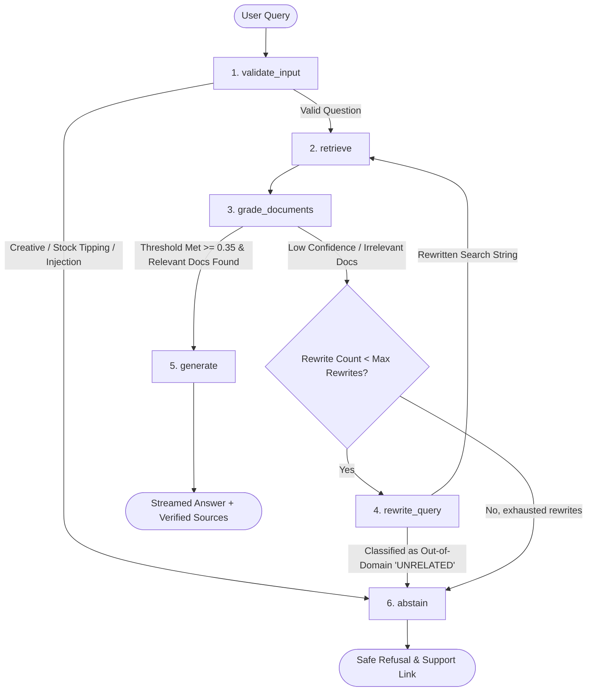

# 🏦 Scripbox Knowledge Base Assistant (Production V2)

[](https://github.com/E-YAML/Scripbox-KB-Retriever/actions/workflows/ci.yml)
[](https://www.python.org/downloads/)
[](https://scripbox-kb-retriever-exmxwcgiylraldyjq3kk92.streamlit.app/)
[](https://cloud.qdrant.io/)
[](https://github.com/langchain-ai/langgraph)
[](https://groq.com/)

A production-ready, cyclic Self-Corrective RAG (Retrieval-Augmented Generation) assistant that answers investor questions from the official [Scripbox Help Center](https://help.scripbox.com/support/solutions).

Live application deployed at: **[scripbox-kb-retriever-exmxwcgiylraldyjq3kk92.streamlit.app](https://scripbox-kb-retriever-exmxwcgiylraldyjq3kk92.streamlit.app/)**

---

## 🌟 Key Capabilities

- **Cyclic Self-Corrective RAG (LangGraph)**: Evaluates retrieval quality before generating. Rewrites search queries and re-retrieves if confidence is low, and gracefully abstains if context is missing.
- **Hosted Persistent Vector Store (Qdrant Cloud)**: Chunks and embeddings are stored on a cloud-hosted vector cluster (`us-east4`), making the application fully stateless and resilient across Streamlit Cloud restarts.
- **Dual Vector Backend**: Seamlessly supports both hosted **Qdrant Cloud** and offline **ChromaDB** with automatic fallback.
- **Dual LLM Provider with Streaming Failover**: Primary streaming via **Groq** (`openai/gpt-oss-120b`) with automatic fallback to **Google Gemini** (`gemini-2.5-flash`) on rate-limit or downtime.
- **Privacy-Safe Structured Observability**: High-fidelity JSON telemetry on every query cycle with a strict Zero-PII guarantee (no user queries or completion bodies are ever logged).
- **Automated Evaluation Gate**: Built-in regression test suite with quality gates: **100% Abstention Gate** and **$\ge$ 80% Recall@5 Gate** (currently 100%).
- **Staged Ingestion & Zero-Downtime Rollback CLI**: Multi-version release manager supporting crawl, diff, isolated build, atomic pointer swaps, and instant rollbacks.
- **Docker Containerization**: Production multi-stage `Dockerfile` and `docker-compose.yml` with health checks and non-root execution.

---

## 🔄 Architecture & State Machine

The pipeline uses a compiled state machine built with **LangGraph**. Unlike naive one-shot RAG, it iteratively verifies relevance before answering:



### Node-by-Node Breakdown

| Node | Purpose | Technical Implementation |
| :--- | :--- | :--- |
| **`validate_input`** | Fast-path guardrails | Sanitizes input and bounds length ($1 \le L \le 2000$). Catches prompt injections, creative queries (*"write a poem"*), and stock-picking requests (*"what stock should I buy"*) in **$< 1\text{ ms}$** without calling vector DBs or LLMs. |
| **`retrieve`** | Dense vector search | Over-fetches $K=20$ candidates from Qdrant Cloud using cosine distance. Employs a 30s connection timeout and automatic retry. |
| **`grade_documents`** | Relevance filter & deduplication | Filters candidates using a cosine similarity threshold ($\ge 0.35$). Groups chunks by article title and deduplicates so the best chunk per article is selected up to top-$K=5$. |
| **`rewrite_query`** | Self-correction engine | When retrieval yields low confidence, an LLM rewrites the query using Scripbox domain vocabulary (KYC, SIP, folio, NAV, ELSS). If the query is unrelated, it emits `UNRELATED` to fast-path to abstention. |
| **`generate`** | Grounded streaming | Answers strictly based on the retrieved context using Groq (`openai/gpt-oss-120b`). Automatically fails over to Gemini Flash if Groq hits rate limits. |
| **`abstain`** | Deterministic safe refusal | Returns a safe refusal message with a direct link to Scripbox Support whenever context is insufficient, preventing hallucinations. |

---

## 📊 Data Layer & Semantic Chunking

- **Source Corpus**: 211 scraped help articles from [Scripbox Support Solutions](https://help.scripbox.com/support/solutions) across categories: Account Opening, KYC, Bank Accounts, Portfolio Management, NRI Onboarding, and Taxation.
- **Sliding-Window Semantic Chunking**:
  - Word window: **400 words** (~520 tokens)
  - Overlap: **80 words** to preserve contextual transitions
  - Header hierarchy: Each chunk embeds section breadcrumbs (`Category > Folder > Article > Section`)
  - Content hashing: SHA-256 content hashes for update detection
  - Total chunks generated: **240 semantic chunks**
- **Dense Embedding Model**: `sentence-transformers/all-MiniLM-L6-v2` (384-dimensional dense vectors).

---

## 🛡️ Vector Database & Resilience

The application supports both cloud and local vector stores:

| Vector DB | Backend Mode | Storage | Use Case |
| :--- | :--- | :--- | :--- |
| **Qdrant Cloud** | SaaS Managed Cluster (`us-east4`) | Hosted Vector DB (Free Tier: 1GB) | Production, Streamlit Cloud |
| **ChromaDB** | Local embedded (`./chroma_db`) | Local SQLite / HNSW binary files | Offline development, local testing |

### High-Availability Features
- **30-Second Timeout**: Designed for cross-cloud network calls (e.g. AWS Streamlit Cloud $\rightarrow$ GCP Qdrant Cloud).
- **Outbound Compatibility**: Uses standard HTTPS REST (`prefer_grpc=False`) to avoid outbound proxy/firewall drops.
- **Automatic Local Fallback**: If Qdrant Cloud ever experiences a temporary network blip, `KBStore` automatically falls back to local ChromaDB if available.

---

## 🔒 Privacy-Safe Structured Observability

The application emits structured JSON logs to `stderr` on every pipeline step:

```json
{"event": "retrieval", "request_id": "8c2b4444-bbf7-42ce-9d63-ba29f2541b48", "duration_ms": 742.6, "candidate_count": 20, "relevant_count": 5, "top_score": 0.7071, "confidence_decision": "sufficient", "rewrite_count": 0, "ts": 1795595133.87}
{"event": "generation", "request_id": "8c2b4444-bbf7-42ce-9d63-ba29f2541b48", "provider": "groq", "fallback_reason": null, "ttft_ms": null, "total_ms": 1459.4, "error_class": null, "ts": 1795595135.33}
{"event": "response", "request_id": "8c2b4444-bbf7-42ce-9d63-ba29f2541b48", "status": "success", "rewrite_count": 0, "total_ms": 2213.1, "ts": 1795595135.33}
```

### Zero-PII Contract
- **Never Logged**: Raw user questions, prompt templates, completion texts, or personal identifiers.
- **Always Logged**: Latencies, candidate counts, similarity scores, rewrite counts, provider fallbacks, and error types.

---

## 🧪 Automated Evaluation Suite (`eval/`)

The evaluation framework verifies retrieval accuracy and guardrail safety against curated YAML test fixtures:

```bash
# Run all evaluation fixtures
python -m eval.runner

# Run specific fixture suite
python -m eval.runner --fixtures kyc
python -m eval.runner --fixtures abstention

# Fast CI verification mode (mock providers, ~30ms runtime)
python -m eval.runner --mock
```

### Quality Gates

| Evaluation Gate | Target | Current Score | Status |
| :--- | :--- | :--- | :--- |
| **Recall@5 Gate** | $\ge 80\%$ | **100%** (8/8) | ✅ Passed |
| **Abstention Gate** | $100\%$ | **100%** (6/6) | ✅ Passed |
| **Overall Pass Rate** | $\ge 90\%$ | **100%** (15/15) | ✅ Passed |

---

## 📦 Staged Ingestion & Atomic Rollback CLI (`ingest.py`)

A zero-downtime release management CLI for knowledge base updates:

```bash
# 1. Crawl / stage articles into a timestamped release directory
python ingest.py crawl [--source articles.json]

# 2. Diff staged articles against active release (new, updated, deleted)
python ingest.py diff [--release <id>]

# 3. Chunk and build vector index in isolation
python ingest.py build [--release <id>] [--backend chroma|qdrant]

# 4. Smoke test and atomically promote release to active
python ingest.py promote [--release <id>]

# 5. Instant rollback to previous release pointer
python ingest.py rollback

# 6. View active release metadata and history
python ingest.py status
```

### Directory Layout
```
data/releases/
├── current.json            # Atomically swapped pointer to active release
├── manifest.json           # Registry of all staged, active, and archived releases
└── 20261125T013000Z/
    ├── articles.json       # Scraped knowledge base articles
    ├── build_info.json     # Chunker & vector collection metadata
    └── chroma_db/          # Isolated ChromaDB directory (if chroma backend)
```

---

## 🚀 Deployment Guide

### Option 1: Streamlit Community Cloud (Current Production)

1. Fork or clone this repository.
2. Sign in to [share.streamlit.io](https://share.streamlit.io/).
3. Select your repository, set branch to `main`, and main file path to `app.py`.
4. Open **Advanced Settings** $\rightarrow$ **Secrets**, and enter your configuration:

```toml
# ── Vector DB (Qdrant Cloud) ──────────────────────────
VECTOR_DB_TYPE = "qdrant"
QDRANT_URL     = "https://84deee20-6ba6-46cd-a3ee-17724e24af23.us-east4-0.gcp.cloud.qdrant.io"
QDRANT_API_KEY = "your-qdrant-api-key"

# ── Primary LLM Provider (Groq) ──────────────────────
GROQ_API_KEY   = "gsk_..."
GROQ_MODEL     = "openai/gpt-oss-120b"

# ── Optional Fallback Provider (Gemini) ──────────────
# GEMINI_API_KEY = "AIza..."
# GEMINI_MODEL   = "gemini-2.5-flash"

# ── Pipeline Tuning ──────────────────────────────────
TOP_K               = 5
RETRIEVAL_THRESHOLD = 0.35
MAX_REWRITES        = 2
MAX_CONCURRENCY     = 4
```

5. Click **Deploy**. Streamlit Cloud connects directly to your persistent Qdrant Cloud cluster.

---

### Option 2: Docker & Docker Compose

Run the application as an isolated container:

```bash
# 1. Create a .env file with your API keys:
echo "GROQ_API_KEY=gsk_..." >> .env
echo "VECTOR_DB_TYPE=qdrant" >> .env
echo "QDRANT_URL=https://..." >> .env
echo "QDRANT_API_KEY=..." >> .env

# 2. Start the service:
docker compose up --build -d

# 3. View live logs:
docker compose logs -f

# 4. Access the UI:
# http://localhost:8501
```

---

### Option 3: Local Development Quickstart

```bash
# 1. Clone repository & set up environment
git clone https://github.com/E-YAML/Scripbox-KB-Retriever.git
cd Scripbox-KB-Retriever
python -m venv .venv

# On Linux/macOS:
source .venv/bin/activate
# On Windows:
.venv\Scripts\Activate.ps1

# 2. Install dependencies
pip install -e ".[dev]"

# 3. Configure secrets in .streamlit/secrets.toml
mkdir .streamlit
cat << EOF > .streamlit/secrets.toml
GROQ_API_KEY = "gsk_..."
VECTOR_DB_TYPE = "qdrant"
QDRANT_URL = "https://..."
QDRANT_API_KEY = "..."
EOF

# 4. Run tests & verification
pytest -v
python -m eval.runner --mock

# 5. Launch the Streamlit application
streamlit run app.py
```

---

## ⚙️ Configuration Reference

All settings can be specified via Streamlit secrets (`.streamlit/secrets.toml`), environment variables, or `.env`:

| Key | Type | Default | Description |
| :--- | :--- | :--- | :--- |
| `VECTOR_DB_TYPE` | `string` | `"chroma"` | Vector database backend: `"chroma"` or `"qdrant"`. |
| `QDRANT_URL` | `string` | `""` | Qdrant Cloud cluster endpoint. |
| `QDRANT_API_KEY` | `string` | `""` | Qdrant Cloud API key. |
| `GROQ_API_KEY` | `string` | `""` | Groq Cloud API key. |
| `GROQ_MODEL` | `string` | `"openai/gpt-oss-120b"` | Groq model name for generation and query rewriting. |
| `GEMINI_API_KEY` | `string` | `""` | Google AI Studio API key (used as fallback). |
| `GEMINI_MODEL` | `string` | `"gemini-2.5-flash"` | Gemini model used on fallback. |
| `TOP_K` | `int` | `5` | Maximum number of verified sources passed to LLM context. |
| `RETRIEVAL_CANDIDATES` | `int` | `20` | Candidate chunk over-fetch pool before grading. |
| `RETRIEVAL_THRESHOLD` | `float` | `0.35` | Minimum cosine similarity to pass document grading. |
| `MAX_REWRITES` | `int` | `2` | Maximum query rewrite cycles before forcing abstention. |
| `MAX_CONCURRENCY` | `int` | `4` | In-process concurrency semaphore slots on QueryService. |
| `CONCURRENCY_TIMEOUT` | `float` | `15.0` | Maximum seconds to wait for a slot before returning busy. |

---

## 📁 Repository Structure

```
Scripbox-KB-Retriever/
├── .github/workflows/
│   └── ci.yml                # CI: ruff, mypy, pytest, and eval gate
├── data/releases/            # Staged ingestion releases & current.json
├── eval/
│   ├── fixtures/
│   │   ├── abstention.yaml   # Negative/out-of-domain evaluation test cases
│   │   └── kyc.yaml          # In-domain KYC/banking test cases with expected URLs
│   └── runner.py             # Evaluation runner and quality gate assertions
├── scripbox_kb/              # Core application package
│   ├── chunker.py            # Sliding-window semantic chunker
│   ├── config.py             # AppConfig dataclass and secret resolution
│   ├── graph.py              # LangGraph StateGraph compiler and conditional routing
│   ├── graph_nodes.py        # Pipeline node handlers (validate, retrieve, grade, etc.)
│   ├── graph_state.py        # TypedDict RAG state definition
│   ├── kb_store.py           # Unified Qdrant Cloud & ChromaDB store
│   ├── observability.py      # Structured JSON telemetry logging
│   ├── prompting.py          # System prompts & rewriter templates
│   ├── providers.py          # Groq & Gemini streaming clients with fallback
│   └── service.py            # Thread-safe QueryService with concurrency semaphore
├── tests/                    # 61 unit and integration tests
│   ├── test_chunker.py
│   ├── test_config.py
│   ├── test_graph.py
│   ├── test_ingest.py
│   ├── test_kb_store.py
│   ├── test_observability.py
│   ├── test_prompting.py
│   ├── test_providers.py
│   └── test_service.py
├── .dockerignore
├── .gitignore
├── app.py                    # Streamlit frontend with real-time streaming
├── build_index.py            # One-off vector index builder
├── docker-compose.yml        # Docker Compose configuration
├── Dockerfile                # Production multi-stage Dockerfile
├── ingest.py                 # Staged ingestion & atomic rollback CLI
├── pyproject.toml            # Project packaging & tool configuration
├── README.md                 # Project documentation
├── requirements.txt          # Production dependencies
└── scraper.py                # Web scraper for help.scripbox.com
```

---

## ⚖️ License

Distributed under the Apache 2.0 License. Sourced articles and content belong to [Scripbox](https://scripbox.com).
